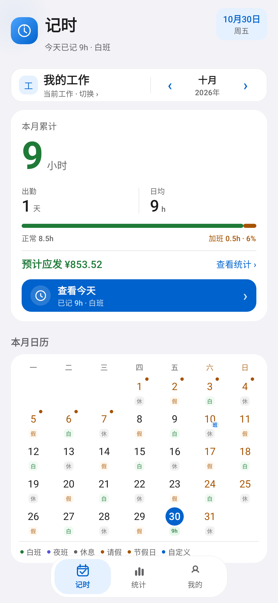
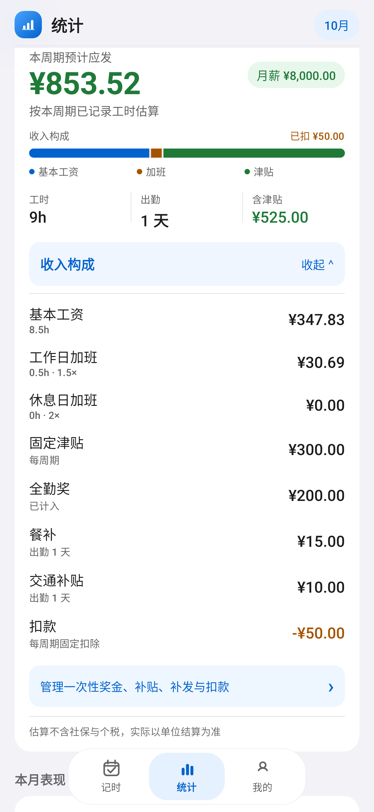
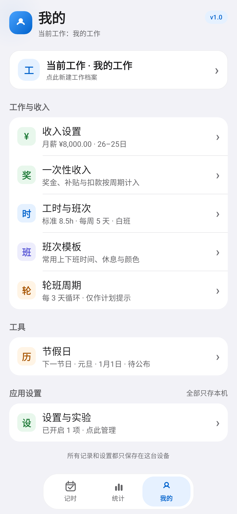
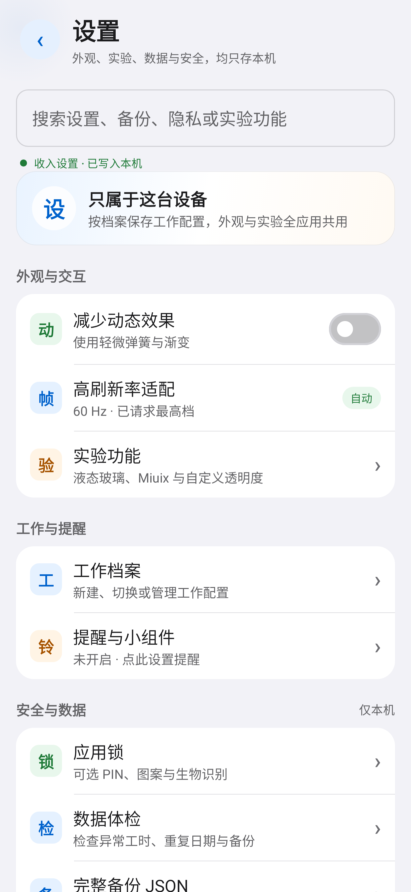

<p align="center">
  
</p>

<h1 align="center">记一笔 · Work Ledger</h1>

<p align="center">
  <strong>本地优先的 Android 工时记录应用</strong><br/>
  按天记工时、自动算收入、备份与桌面小组件都留在本机
</p>

<p align="center">
  <a href="https://t.me/DimensionID"></a>
  
  
  <a href="LICENSE"></a>
  
</p>

---

## 截图

<table>
  <tr>
    <td align="center" width="50%">
      <br/>
      <sub><b>记时</b> · 月历、今日工时与预计收入</sub>
    </td>
    <td align="center" width="50%">
      <br/>
      <sub><b>统计</b> · 收入构成、工时与出勤</sub>
    </td>
  </tr>
  <tr>
    <td align="center" width="50%">
      <br/>
      <sub><b>我的</b> · 工作档案、收入与应用设置</sub>
    </td>
    <td align="center" width="50%">
      <br/>
      <sub><b>设置</b> · 外观、实验、数据与安全</sub>
    </td>
  </tr>
</table>

## 功能

- **月历记录**：点已有日期看详情，点空白日期直接记一笔；支持补记、连续录入和未来班次预览。
- **两种记法**：直接填总时长，或填上下班时间与休息时长，由应用自动算工时。
- **收入估算**：时薪、月薪、加班倍率、固定津贴、全勤奖、餐补、交通补贴和扣款分开计算。
- **工资周期**：支持 1–31 日任意起始日，跨月周期、一次性收入和补发按周期归属。
- **统计与报表**：收入构成、月度趋势、12 个月矩阵、区间报表和年度概览。
- **备份与恢复**：完整 JSON、加密 JSON、仅设置 JSON、CSV 导入导出，全部通过系统文件选择器保存在本机。
- **提醒与小组件**：下班、月末和定期备份提醒；桌面小组件显示今天与本周工时。
- **应用锁**：PIN、九点图案和系统生物识别，凭据只保存在本机。
- **本地优先**：不申请 `INTERNET` 权限，没有账号、云同步、广告或联网统计 SDK。
- **细节适配**：Miuix 实验控件、液态玻璃、200% 字体、320dp、横屏、分屏、平板和折叠屏回归。

## 下载

最新版本：**[v1.0.0 Release](https://github.com/Tuanzi010/Work-ledger/releases/latest)**

| 文件 | 说明 |
| --- | --- |
| `记一笔-v1.0.0.apk` | 可直接安装的 Release 签名 APK |
| `记一笔-v1.0.0-工程源码.zip` | 对应本仓库的完整源码与文档快照 |
| `SHA-256` | 见 Release 附件中的校验值文件 |

> 当前使用项目 Release 签名，不是应用商店分发签名。

## 隐私与数据

- APK 只声明 `POST_NOTIFICATIONS`、`RECEIVE_BOOT_COMPLETED` 和 `USE_BIOMETRIC`，**不包含 `INTERNET`**。
- 工时记录保存在 Room v6，设置保存在 DataStore；所有记录与偏好只属于这台设备。
- 备份、CSV 和报表由用户主动导出，不经过任何服务器。
- 没有账号体系、云同步、广告 SDK 或联网统计。

## 技术栈

| 层 | 技术 |
| --- | --- |
| 语言 | Kotlin 2.0.21 |
| UI | Jetpack Compose + Material 3 |
| 数据库 | Room v6（全链路 v1 → v6 迁移） |
| 设置 | DataStore Preferences |
| 构建 | AGP 8.7.3 · JDK 17 · compileSdk 35 |
| 测试 | JUnit + Robolectric + Compose UI Test |

## 从源码构建

环境要求：JDK 17 或 21、Android SDK 35。

```powershell
git clone https://github.com/Tuanzi010/Work-ledger.git
cd Work-ledger
./gradlew testDebugUnitTest lintDebug assembleDebug
```

构建产物位于 `app/build/outputs/apk/debug/app-debug.apk`。

## 项目文档

- [完整开发记录与版本历史](docs/README-FULL.md)
- [v1.0.0 发布检查点](docs/aegis/work/2026-10-31-v1.0.20/20-checkpoint.md)
- [MIT 许可证](LICENSE)

## 联系

<p align="center">
  <a href="https://t.me/DimensionID"></a>
</p>

<p align="center">
  有问题、建议或想跟进后续版本，欢迎来 Telegram 找 <b>CiYuanOvO</b>
</p>

## 许可证

本项目使用 [MIT License](LICENSE) 开源。
